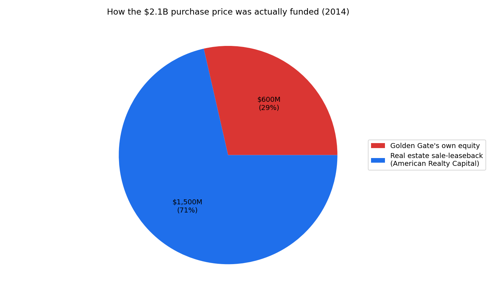
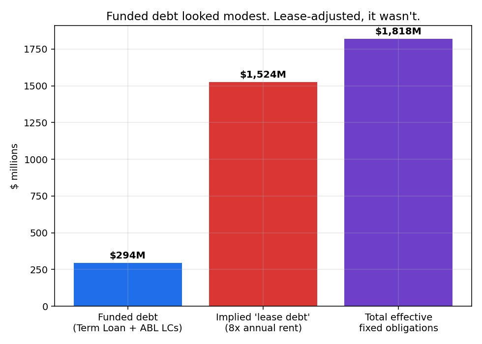

# Red Lobster — When the Sponsor Already Left

A reconstruction of Red Lobster's 2014 sale by Darden Restaurants to Golden
Gate Capital (with a simultaneous real-estate sale-leaseback) through its
May 2024 Chapter 11 filing — built entirely from SEC filings, the actual
bankruptcy court declaration, and press reporting. No invented numbers;
every figure cited.

**The headline**: Golden Gate Capital paid $2.1B for Red Lobster in 2014 —
but put up only **$600M of its own money**. The other **$1.5B came from
selling Red Lobster's own real estate** and leasing it back. Golden Gate
**fully exited in 2020**. Four years later, under completely different
ownership (Thai Union, "Seafood Alliance," and former management), the
company collapsed — not because of conventional LBO debt (funded debt at
filing was a modest $294M) but because of **$190.5 million/year of
above-market rent** from the 2014 sale-leaseback, compounded by a specific
operational misstep (making "Endless Shrimp" a permanent $20 menu item)
and a sharp post-pandemic traffic decline. In September 2024, the senior
lender **Fortress** simply credit-bid its own debt and took the company —
wiping out Thai Union, Seafood Alliance, and management's equity entirely.

This is a deliberately different kind of case study than this repo's
companion project, [toys-r-us-lbo-case-study](https://github.com/bolatbekm/toys-r-us-lbo-case-study):
there, one sponsor held conventional debt for 12 years until it broke the
company. Here, the sponsor who engineered the structural problem had
already left — the owners who lost everything inherited a burden they
didn't create.

## What's in this repo

| Path | What it is |
|---|---|
| [`docs/sources.md`](docs/sources.md) | Every figure cited — including an honest 2017-2022 data gap, since Red Lobster had no SEC reporting obligation as a private company |
| [`docs/deal_narrative.md`](docs/deal_narrative.md) | The plain-language story, year by year |
| [`notebook/red_lobster_analysis.ipynb`](notebook/red_lobster_analysis.ipynb) | Python analysis: the funding-mix chart, a lease-adjusted leverage analysis, the 2023 cash-collapse walk, and the ownership timeline |
| [`model/RedLobster_LBO_Model.xlsx`](model/RedLobster_LBO_Model.xlsx) | A formula-driven Excel model covering the 2014 deal, the lease-adjusted leverage analysis, the liquidity collapse, and the final ownership outcome |
| [`data/processed/`](data/processed/) | Clean CSVs feeding both the notebook and the Excel model |
| [`data/raw/`](data/raw/) | The actual source documents — Darden's 2014 investor presentation and the 124-page bankruptcy first-day declaration — kept verbatim |

## The headline charts



Golden Gate's own equity covered less than a third of the purchase price.



Funded debt at the 2024 filing (~$294M) looks almost conservative in
isolation. Capitalized at a standard rule-of-thumb multiple, the real
fixed-obligation load — mostly invisible as "debt" on any balance sheet —
was several times larger.

More charts (the pre-2014 EBITDA decline, the 2023 cash-collapse
waterfall) are in the notebook and in `assets/`.

## How to reproduce this

```bash
pip install -r requirements.txt

python scripts/build_processed_data.py

cd notebook && python build_notebook.py && jupyter nbconvert --to notebook --execute --inplace red_lobster_analysis.ipynb

cd ../model && python build_excel_model.py
```

## What this is not

The "lease-adjusted leverage" multiple (8x annual rent) is this project's
own illustrative modeling choice — a standard credit-analysis rule of
thumb, not a figure from any Red Lobster filing. Golden Gate Capital's
2020 exit terms are not estimated anywhere in this repo; no source
reviewed disclosed them, so the relevant cells are left explicitly blank
rather than guessed. See `docs/sources.md` for the complete list of what's
a cited fact versus a labeled assumption.
